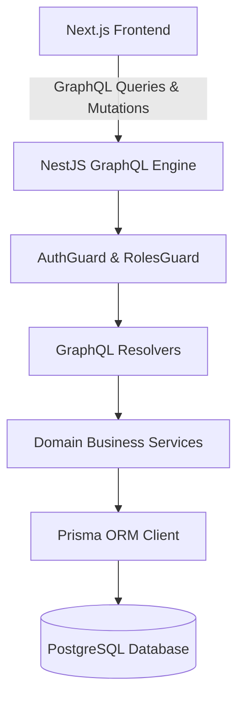

# FixFlow Architecture Overview

FixFlow is designed as a **Modular Monolith** optimized for university-level enterprise web technology evaluations. It couples high operational coherence with clear domain isolation, avoiding the unnecessary distributed complexity of microservices while maintaining strict separation of concerns.

---

## 1. Architectural Style & Tech Stack

- **Client Layer**: Next.js 14 (App Router, React 18, TypeScript, Tailwind CSS)
- **Data Transfer / API Layer**: Apollo GraphQL (Code-First schema generation, strong typing, field-level resolution)
- **Application Server Layer**: NestJS Modular Monolith (Dependency Injection, Guards, Interceptors, Pipes)
- **Data Access & ORM**: Prisma ORM with strict foreign key constraints and TypeScript type generation
- **Persistence**: PostgreSQL 16
- **Authentication**: Stateless JSON Web Tokens (JWT) with bcrypt salt hashing

---

## 2. Monorepo Structure

```
FixFlow/
├── backend/                       # NestJS Application
│   ├── prisma/
│   │   ├── schema.prisma          # PostgreSQL Relational Schema & Enums
│   │   └── seed.ts                # Database Seeder
│   └── src/
│       ├── common/                # Shared Guards, Decorators, SLA Engine
│       ├── auth/                  # JWT Authentication & RBAC Guards
│       ├── users/                 # User management & roles
│       ├── locations/             # Campus buildings, floors, rooms
│       ├── asset-categories/      # Asset classification
│       ├── assets/                # Asset lifecycle, condition, status, QR ID
│       ├── maintenance-requests/  # Request workflow & deterministic SLA engine
│       ├── work-orders/           # Technician assignments & repair logs
│       ├── preventive-maintenance/# Preventive recurring schedules
│       ├── analytics/             # Operational KPIs & metrics
│       ├── audit/                 # System audit logs
│       ├── notifications/         # In-app notifications
│       └── health/                # System health check query & controller
├── frontend/                      # Next.js Application
│   └── src/
│       ├── app/                   # App Router pages (/login, /dashboard, /requests, /assets, ...)
│       ├── components/            # Reusable UI components (Modals, Badges, Tables, Forms)
│       └── lib/                   # Apollo Client, auth context, SLA calculations
├── infrastructure/                # Docker & deployment manifests
└── docs/                          # Architecture, database, API, setup guides
```

---

## 3. Communication Patterns



All interactions use GraphQL:
- **Queries**: Fetching operational data, nested relations (e.g. Asset with Category, Location, and Open Requests).
- **Mutations**: Performing validated state transitions and transactions.
- **Resolver-Level Security**: Guards inspect JWT claims directly on the server before query or mutation execution.
