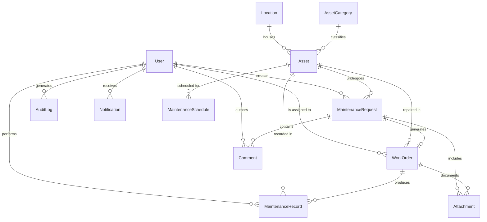

# FixFlow Database Schema & Entity Relationships

FixFlow persists its entire operational lifecycle within a normalized relational schema on PostgreSQL, managed via Prisma ORM.

---

## 1. Entity Relationship Diagram

---

## 2. Core Tables Summary

| Entity | Description | Key Fields |
|---|---|---|
| `User` | Institutional users across 4 distinct roles | `id`, `email`, `role`, `passwordHash`, `department` |
| `Location` | Physical campus structures | `id`, `name`, `code`, `building`, `floor`, `roomNumber` |
| `AssetCategory` | Classification of equipment | `id`, `name`, `code`, `defaultMaintenanceIntervalDays` |
| `Asset` | Physical campus hardware & infrastructure | `id`, `assetTag`, `status`, `criticality`, `conditionRating`, `qrIdentifier` |
| `MaintenanceRequest` | Issue reported by campus member | `id`, `requestNumber`, `priority`, `status`, `slaDeadline`, `slaBreached` |
| `WorkOrder` | Technician dispatch job | `id`, `orderNumber`, `status`, `instructions`, `workNotes`, `partsUsed` |
| `MaintenanceSchedule` | Preventive maintenance definitions | `id`, `assetId`, `frequencyDays`, `nextDueDate`, `isEnabled` |
| `MaintenanceRecord` | Historical immutable maintenance logs | `id`, `assetId`, `actionTaken`, `repairDetails`, `dateCompleted` |
| `Comment` | Collaborative discussions on requests | `id`, `requestId`, `authorId`, `content`, `isInternal` |
| `Attachment` | Media attachments and repair evidence | `id`, `fileUrl`, `fileName`, `fileType`, `fileSize` |
| `AuditLog` | Security and compliance audit trail | `id`, `actorId`, `action`, `entity`, `entityId`, `timestamp` |
| `Notification` | User in-app notifications | `id`, `userId`, `title`, `message`, `isRead` |

---

## 3. Enumerations

- **`Role`**: `REQUESTER`, `TECHNICIAN`, `FACILITY_MANAGER`, `ADMIN`
- **`AssetStatus`**: `OPERATIONAL`, `UNDER_MAINTENANCE`, `OUT_OF_SERVICE`, `RETIRED`
- **`Criticality`**: `LOW`, `MEDIUM`, `HIGH`, `CRITICAL`
- **`Priority`**: `LOW`, `MEDIUM`, `HIGH`, `CRITICAL`
- **`RequestStatus`**: `OPEN`, `TRIAGED`, `ASSIGNED`, `IN_PROGRESS`, `RESOLVED`, `VERIFIED`, `CLOSED`, `REOPENED`
- **`WorkOrderStatus`**: `PENDING`, `ACCEPTED`, `IN_PROGRESS`, `ON_HOLD`, `COMPLETED`, `CANCELLED`
- **`ScheduleStatus`**: `UPCOMING`, `DUE`, `OVERDUE`, `COMPLETED`
